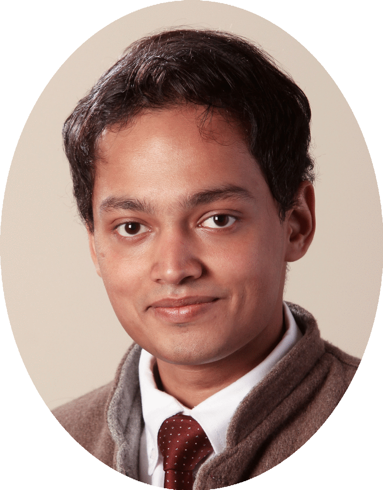

>**email**: *firstnamelastname*@cmu.edu

# Hello, there 👋. My name is **Karan Singh**.

I am an Assistant Professor of Operations Research at the [Tepper School of Business](https://www.cmu.edu/tepper/index.html) at Carnegie Mellon University. I study the algorithmic aspects of machine learning. I am especially interested in interactive learning paradigms, like reinforcement learning. My research both borrows techniques from and synthesizes tools in online learning, mathematical optimization, statistics and control theory. Some of my recent research interests include:

+ **Nonstochastic Control** paves an algorithmic, against a traditionally analytic, foundation for control theory. We give provably efficient instance-optimal control algorithms. By extending online learning to stateful systems and establishing low-regret guarantees, these go beyond both average-case notions of optimal control and worst-case notions in robust control.
+ **Algorithmic Reductions:** Can one efficiently solve *hard* learning problems (e.g., reinforcement learning) given blackbox solvers for *well-understood, easier* ones (e.g., weak classifiers)? Are such algorithmic reductions sample-efficient? We answer such these to give efficient algorithms for online boosting, boosting for RL, and RL with concave rewards.
+ **Privacy and Online Learning:** Online convex optimization provides robust, yet performant, algorithms for learning and online decision-making. What is the best achievable regret for OCO under privacy constraints? This links to an older question on steadfastness in online learning, and we give the first results which match the best obtainable in non-private settings.

I completed my PhD in Computer Science at [Princeton University](https://www.cs.princeton.edu/), advised by [Elad Hazan](https://www.ehazan.com/). Following this, I was a postdoc at [Microsoft Research](https://www.microsoft.com/en-us/research/) in Redmond. Long ago, I was a Computer Science undergrad at Indian Institute of Technology (IIT) Kanpur.

# Publications

[Learning to Price with Persuasion](https://arxiv.org/pdf/2608.16699) 
with Maria-Florina Balcan and Tejas Pagare 
*Neural Information Processing Systems (NeurIPS)*, 2026 **Spotlight** (<1.3% of submissions) 
proceedings soon | [arXiv](https://arxiv.org/pdf/2608.16699)

[First-Order Regret for Online Convex Optimization with Memory and Online Nonstochastic Control](https://openreview.net/forum?id=yi9BRZRbpN) 
*Neural Information Processing Systems (NeurIPS)*, 2026 
proceedings soon | arXiv soon

[Introduction to Online Control](https://www.cambridge.org/core/books/introduction-to-online-control/4EAE3F32A195899D073E496D2EDBD730) 
with Elad Hazan 
*Cambridge University Press, 2026* 
[link](https://www.cambridge.org/core/books/introduction-to-online-control/4EAE3F32A195899D073E496D2EDBD730) | [arXiv](https://arxiv.org/pdf/2211.09619)

[How to Sell High-Dimensional Data Optimally](https://arxiv.org/pdf/2510.15214) 
with Andrew Li, R. Ravi, Zihong Yi and Weizhong Zhang 
*International Conference on Web and Internet Economics (WINE), 2025* 
proceedings soon | [arXiv](https://arxiv.org/pdf/2510.15214)

[The Theory of Online Control](https://projecteuclid.org/journals/statistical-science/volume-40/issue-4/The-Theory-of-Online-Control/10.1214/25-STS998.short) 
with Elad Hazan 
*Statistical Science, Vol. 40, 2025* 
[journal](https://projecteuclid.org/journals/statistical-science/volume-40/issue-4/The-Theory-of-Online-Control/10.1214/25-STS998.short) | arXiv soon

[Sample-Optimal Agnostic Boosting with Unlabeled Data](https://arxiv.org/pdf/2503.04706) 
with Udaya Ghai 
*International Conference on Machine Learning (ICML)*, 2025 
[proceedings](https://proceedings.mlr.press/v267/ghai25a.html) | [arXiv](https://arxiv.org/pdf/2503.04706)

[Faster Global Minimum Cut with Predictions](https://arxiv.org/pdf/2503.05004) 
with Benjamin Moseley and Helia Niaparast 
*International Conference on Machine Learning (ICML)*, 2025 
[proceedings](https://proceedings.mlr.press/v267/niaparast25a.html) | [arXiv](https://arxiv.org/pdf/2503.05004)

[Sample-Efficient Agnostic Boosting](https://papers.nips.cc/paper_files/paper/2024/file/b63a24a1832bd14fa945c71f535c0095-Paper-Conference.pdf) 
with Udaya Ghai 
*Neural Information Processing Systems (NeurIPS)*, 2024 
[proceedings](https://papers.nips.cc/paper_files/paper/2024/file/b63a24a1832bd14fa945c71f535c0095-Paper-Conference.pdf) | [arXiv](https://arxiv.org/pdf/2312.11534)

[Improved Differentially Private and Lazy Online Convex Optimization: Lower Regret without Smoothness Requirements](https://arxiv.org/pdf/2312.11534) 
with Naman Agarwal, Sayten Kale and Abhradeep Thakurta 
*International Conference on Machine Learning (ICML)*, 2024 
[proceedings](https://proceedings.mlr.press/v235/agarwal24d.html) | [arXiv](https://arxiv.org/pdf/2312.11534)

[Online Nonstochastic Model-Free Reinforcement Learning](https://papers.nips.cc/paper_files/paper/2023/file/491bbea0db340e2d0bc1feea9059909a-Paper-Conference.pdf) 
with Udaya Ghai, Arushi Gupta, Wenhan Xia and Elad Hazan 
*Neural Information Processing Systems (NeurIPS)*, 2023 
[proceedings](https://papers.nips.cc/paper_files/paper/2023/hash/491bbea0db340e2d0bc1feea9059909a-Abstract-Conference.html) | [arXiv](https://arxiv.org/pdf/2305.17552)

[Differentially Private and Lazy Online Convex Optimization](https://proceedings.mlr.press/v195/agarwal23d/agarwal23d.pdf) 
with Naman Agarwal, Sayten Kale and Abhradeep Thakurta 
*Conference on Learning Theory (COLT)*, 2023 
[proceedings](https://proceedings.mlr.press/v195/agarwal23d.html) | arXiv soon

[Best of Both Worlds in Online Control: Competitive Ratio and Policy Regret](https://proceedings.mlr.press/v211/goel23a/goel23a.pdf) 
with Gautam Goel, Naman Agarwal and Elad Hazan 
*Learning for Dynamics and Control (L4DC)*, 2023 
[proceedings](https://proceedings.mlr.press/v211/goel23a.html) | [arXiv](https://arxiv.org/pdf/2211.11219)

[Variance-reduced Conservative Policy Iteration](https://proceedings.mlr.press/v201/agarwal23a/agarwal23a.pdf) 
with Naman Agarwal and Brian Bullins 
*Algorithmic Learning Theory (ALT)*, 2023 
[proceedings](https://proceedings.mlr.press/v201/agarwal23a.html) | [arXiv](https://arxiv.org/pdf/2212.06283)

[A Boosting Approach to Reinforcement Learning](https://proceedings.neurips.cc/paper_files/paper/2022/file/daf8364f0715a41a469c677c0adc4754-Supplemental-Conference.pdf) 
with Nataly Brukhim and Elad Hazan 
*Neural Information Processing Systems (NeurIPS)*, 2022 
[proceedings](https://proceedings.neurips.cc/paper_files/paper/2022/hash/daf8364f0715a41a469c677c0adc4754-Abstract-Conference.html) | [arXiv](https://arxiv.org/pdf/2108.09767)

[Boosting for Online Convex Optimization](http://proceedings.mlr.press/v139/hazan21a/hazan21a.pdf) 
with Elad Hazan 
*International Conference on Machine Learning (ICML)*, 2021 
[proceedings](http://proceedings.mlr.press/v139/hazan21a.html) | [arXiv](https://arxiv.org/pdf/2102.09305)

[A Regret Minimization Approach to Iterative Learning Control](https://proceedings.mlr.press/v139/agarwal21b/agarwal21b.pdf) 
with Naman Agarwal, Elad Hazan, Anirudha Majumdar 
*International Conference on Machine Learning (ICML)*, 2021 
[proceedings](https://proceedings.mlr.press/v139/agarwal21b.html) | [arXiv](https://arxiv.org/pdf/2102.13478)

[Improper Learning for Nonstochastic Control](https://proceedings.mlr.press/v125/simchowitz20a/simchowitz20a.pdf) 
with Max Simchowitz, Elad Hazan 
*Conference on Learning Theory (COLT)*, 2020 
[proceedings](https://proceedings.mlr.press/v125/simchowitz20a.html) | [arXiv](https://arxiv.org/pdf/2001.09254)

[No-Regret Prediction in Marginally Stable Systems](http://proceedings.mlr.press/v125/ghai20a/ghai20a.pdf) 
with Udaya Ghai, Holden Lee, Cyril Zhang, Yi Zhang 
*Conference on Learning Theory (COLT)*, 2020 
[proceedings](https://proceedings.mlr.press/v125/ghai20a.html) | [arXiv](https://arxiv.org/pdf/2002.02064)

[The Nonstochastic Control Problem](https://proceedings.mlr.press/v117/hazan20a/hazan20a.pdf) 
with Elad Hazan, Sham Kakade 
*Algorithmic Learning Theory (ALT)*, 2020 
[proceedings](https://proceedings.mlr.press/v117/hazan20a.html) | [arXiv](https://arxiv.org/pdf/1911.12178)

[Logarithmic Regret for Online Control](https://proceedings.neurips.cc/paper_files/paper/2019/file/78719f11fa2df9917de3110133506521-Paper.pdf) 
with Naman Agarwal, Elad Hazan 
*Neural Information Processing Systems (NeurIPS)*, 2019 **Oral Presentation** (<0.5% of submissions) 
Also, **Best Paper Award** at the OptRL workshop at NeurIPS 2019 
[proceedings](https://proceedings.neurips.cc/paper_files/paper/2019/hash/78719f11fa2df9917de3110133506521-Abstract.html) | [arXiv](https://arxiv.org/pdf/1909.05062)

[Online Control with Adversarial Disturbances](http://proceedings.mlr.press/v97/agarwal19c/agarwal19c.pdf) 
with Naman Agarwal, Brian Bullins, Elad Hazan, Sham Kakade 
*International Conference on Machine Learning (ICML)*, 2019 
[proceedings](https://proceedings.mlr.press/v97/agarwal19c.html) | [arXiv](https://arxiv.org/pdf/1902.08721)

[Provably Efficient Maximum Entropy Exploration](http://proceedings.mlr.press/v97/hazan19a/hazan19a.pdf) 
with Elad Hazan, Sham Kakade, Abby Van Soest 
*International Conference on Machine Learning (ICML)*, 2019 
[proceedings](https://proceedings.mlr.press/v97/hazan19a.html) | [arXiv](https://arxiv.org/pdf/1812.02690)

[Efficient Full-Matrix Adaptive Regularization](http://proceedings.mlr.press/v97/agarwal19b/agarwal19b.pdf) 
with Naman Agarwal, Brian Bullins, Xinyi Chen, Elad Hazan, Cyril Zhang, Yi Zhang 
*International Conference on Machine Learning (ICML)*, 2019 
[proceedings](https://proceedings.mlr.press/v97/agarwal19b.html) | [arXiv](https://arxiv.org/pdf/1806.02958)

[Spectral Filtering for General Linear Dynamical Systems](https://proceedings.neurips.cc/paper_files/paper/2018/file/d6288499d0083cc34e60a077b7c4b3e1-Paper.pdf) 
with Elad Hazan, Holden Lee, Cyril Zhang, Yi Zhang 
*Neural Information Processing Systems (NeurIPS)*, 2018 **Oral Presentation** (<0.5% of submissions) 
[proceedings](https://proceedings.neurips.cc/paper_files/paper/2018/hash/d6288499d0083cc34e60a077b7c4b3e1-Abstract.html) | [arXiv](https://arxiv.org/pdf/1802.03981)

[Learning Linear Dynamical Systems via Spectral Filtering](https://proceedings.neurips.cc/paper_files/paper/2017/file/165a59f7cf3b5c4396ba65953d679f17-Paper.pdf) 
with Elad Hazan, Cyril Zhang 
*Neural Information Processing Systems (NeurIPS)*, 2017 **Spotlight** (<5% of submissions) 
Also, **Spotlight Prize** at New York Academy of Sciences' ML Symposium, 2018 
[proceedings](https://proceedings.neurips.cc/paper_files/paper/2017/hash/165a59f7cf3b5c4396ba65953d679f17-Abstract.html) | [arXiv](https://arxiv.org/pdf/1711.00946)

[The Price of Differential Privacy for Online Learning](http://proceedings.mlr.press/v70/agarwal17a/agarwal17a.pdf) 
with Naman Agarwal 
*International Conference on Machine Learning (ICML)*, 2017 
[proceedings](http://proceedings.mlr.press/v70/agarwal17a) | [arXiv](https://arxiv.org/pdf/1701.07953)

[Efficient Regret Minimization in Non-Convex Games](http://proceedings.mlr.press/v70/hazan17a/hazan17a.pdf) 
with Elad Hazan, Cyril Zhang 
*International Conference on Machine Learning (ICML)*, 2017 
[proceedings](https://proceedings.mlr.press/v70/hazan17a.html) | [arXiv](https://arxiv.org/pdf/1708.00075)

# Technical Reports

[Dynamic Learning System](https://patentimages.storage.googleapis.com/b5/ee/96/2d4272b197b898/US11138513.pdf) 
with Elad Hazan, Cyril Zhang 
*US Patent 11,138,513 B2*, approved Oct 2021

[Machine Learning for Mechanical Ventilation Control](https://arxiv.org/pdf/2102.06779.pdf) 
with Daniel Suo, Cyril Zhang, Paula Gradu, Udaya Ghai, Xinyi Chen, Edgar Minasyan, Naman Agarwal, Julienne LaChance, Tom Zajdel, Manuel Schottdorf, Daniel Cohen, Elad Hazan 
*Machine Learning for Health (ML4H)*, 2021 Workshop Track 
[Featured](https://engineering.princeton.edu/news/2021/01/26/engineering-and-artificial-intelligence-combine-safeguard-patients-lives) in Princeton Engineering news.

[Deluca -- A Differentiable Control Library: Environments, Methods, and Benchmarking](https://montrealrobotics.ca/diffcvgp/assets/papers/1.pdf) 
with Paula Gradu, John Hallman, Daniel Suo, Alex Yu, Naman Agarwal, Udaya Ghai, Cyril Zhang, Anirudha Majumdar, Elad Hazan 
*NeurIPS Workshop on Differentiable Computer Vision & Physics*, 2020 Oral Presentation

[Towards Provable Control for Unknown Linear Dynamical Systems](https://openreview.net/pdf?id=HJGuXK1vM) 
with Sanjeev Arora, Elad Hazan, Holden Lee, Cyril Zhang, Yi Zhang 
*International Conference on Learning Representation (ICLR)*, 2018 Workshop Track

[Dynamic Task Allocation for Crowdsourcing](https://arxiv.org/pdf/1701.08795.pdf) 
with Irineo Cabreros, Angela Zhou 
*ICML Workshop on Data Efficient Machine Learning*, 2016

# Lecture Notes

[Linear Programming](assets/lp-notes.pdf) Fall 2023 
*Less simplex, more geometry and regret minimization. Algorithmic proofs.*

[Statistical Foundations of Operations Research](assets/sfor-notes.pdf) Spring 2026 
*Concentration Inequalities and Statistical Learning Theory.*
